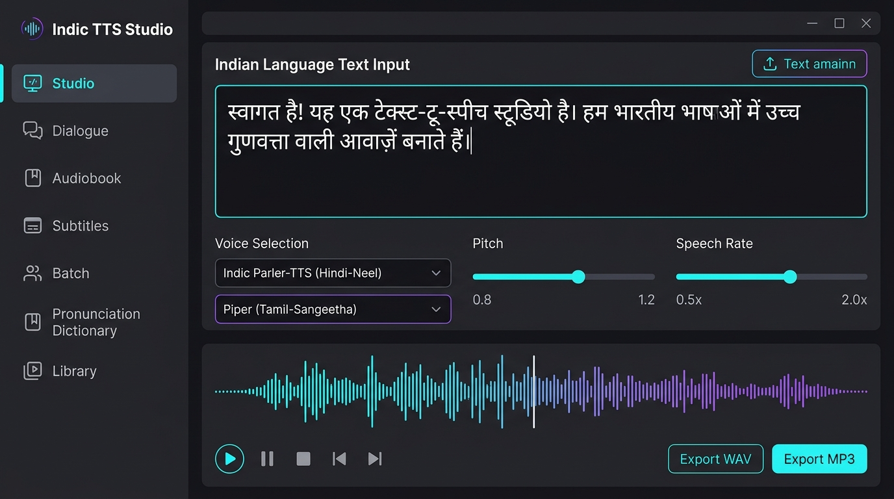
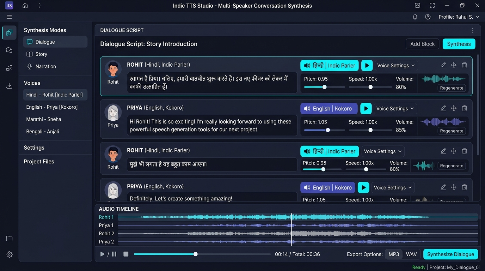

# 🎙️ Indic TTS Studio

A unified, professional-grade desktop Text-to-Speech studio for Indian languages and English. Combines 5 distinct synthesis engines, customizable multi-speaker dialogues, audiobook creation with legacy font decoding, subtitle voiceovers with audio ducking, pronunciation dictionaries, and real-time waveform playback in a modern dark-mode CustomTkinter desktop interface.

---



---

## 🌟 Highlights & Capabilities

### 1. ⚡ Multi-Engine Architecture
Choose the ideal engine for any language, performance profile, or licensing requirement:

| Engine | Provider | Type | Highlights & Voices |
|---|---|---|---|
| **Indic Parler-TTS** | AI4Bharat | GPU Neural | Full neural expression, emotion/mood control, 69 named personas across 18 Indian languages. |
| **Piper Hindi** | sherpa-onnx | Offline CPU | Ultra-fast offline CPU synthesis (`Pratham`, `Priyamvada`, `Rohan`). Real-time factor < 0.2. |
| **Kokoro-82M** | sherpa-onnx | Hybrid CPU/GPU | Lightweight 82M multilingual TTS with Hindi alpha/beta/omega/psi voices and English support. |
| **Microsoft Edge Neural** | Microsoft | Cloud Neural | Crystal-clear cloud voices for 10 Indian languages (`hi-IN-Swara`, `hi-IN-Madhur`, Bengali, Gujarati, Kannada, Malayalam, Marathi, Tamil, Telugu, Urdu) + accents. |
| **SYSPIN VITS** | IISc Bangalore | Offline CPU | Acoustic models covering 9 regional languages (Hindi, Bengali, Marathi, Telugu, Kannada, Chhattisgarhi, Maithili, Magahi, Indian English). |

---

### 2. 🎭 Studio Pages & Workflows



- **🎙️ Studio**: Long-form and short-form text synthesis with sentence-boundary chunking, speed/pitch controls, and live character/duration estimation.
- **💬 Dialogue Mode**: Multi-speaker conversations with automatic tag parsing (`[Rohit] ...` or `Priya: ...`). Mix different voices and engines per character!
- **📖 Audiobook Generator**: Import `.txt`, `.docx`, or `.pdf`. Automatically parses chapters (`Chapter 1`, `अध्याय २`, `भाग ३`). Legacy Hindi PDF fonts (KrutiDev / Chanakya) are seamlessly converted to standard Unicode via `lipi`. Export per-chapter or as a single merged audiobook.
- **🎬 Subtitles → Voiceover**: Load `.srt` files and automatically voice each cue to match the exact video timestamps with auto-ducking for background audio.
- **⚡ Batch Processing**: Synthesize multiple lines or bulk phrases from `.txt` or `.csv`.
- **📖 Pronunciation Dictionary**: Custom phonetic dictionary for acronyms, English loanwords, and proper names, plus automatic Indian currency and number-to-words conversion.
- **🎵 Library & Waveform Player**: Browse all generated clips, search, play with the integrated waveform player, and export to WAV or MP3.
- **🛡️ Offline & License Badges**: Model sizes, offline/online indicators, and explicit licensing transparency for every voice.

---

## ⚖️ Voice Licenses at a Glance

Each voice in the studio displays an explicit color-coded license badge:

| Engine / Voice | License | Commercial Use |
|---|---|---|
| **Indic Parler-TTS** | Apache-2.0 | Yes, with attribution |
| **Kokoro-82M** | Apache-2.0 | Yes, with attribution |
| **SYSPIN VITS** | CC BY 4.0 | Yes, with credit to SYSPIN / IISc Bangalore |
| **Piper (Pratham, Priyamvada)** | CC BY-NC-SA 4.0 | Non-commercial only |
| **Piper (Rohan)** | IIT Madras IndicTTS | Non-commercial / Academic |
| **Microsoft Edge Voices** | Microsoft Service Terms | Cloud service terms apply |

---

## 🚀 Quick Start Guide

### Prerequisites
- Windows 10/11 (64-bit)
- Python 3.10+ (Python 3.12 recommended)
- NVIDIA GPU recommended for Indic Parler-TTS (CPU fallback supported for Piper, Kokoro, and SYSPIN)

### Installation

1. **Clone the repository:**
   ```bash
   git clone https://github.com/ambukirankumarreddy/indic-tts-studio.git
   cd indic-tts-studio
   ```

2. **Set up a virtual environment:**
   ```powershell
   python -m venv .venv
   .\.venv\Scripts\activate
   ```

3. **Install dependencies:**
   ```powershell
   pip install -r requirements.txt
   ```

4. **Launch the Studio:**
   Run via convenience script:
   ```powershell
   .\run.bat
   ```
   Or run with offline mode:
   ```powershell
   .\run.bat --offline
   ```

---

## 📦 Standalone Installer (Inno Setup)

To build a standalone single-file `Setup.exe` with bundled models and Python runtime:
1. Review [installer/BUILD_PLAN.md](installer/BUILD_PLAN.md).
2. Execute the staging script:
   ```powershell
   powershell -ExecutionPolicy Bypass -File installer/stage.ps1
   ```
3. Compile `installer/installer.iss` using Inno Setup compiler.

---

## 📁 Repository Structure

```
indic-tts-studio/
├── assets/                 # UI screenshots and visual assets
├── engines/                # Modular TTS engine drivers
│   ├── base.py             # Abstract base engine class
│   ├── parler_engine.py    # AI4Bharat Indic Parler-TTS
│   ├── sherpa_engines.py   # Piper & Kokoro via sherpa-onnx
│   ├── edge_engine.py      # Microsoft Edge TTS
│   └── syspin_engine.py    # IISc SYSPIN VITS
├── ui/                     # CustomTkinter interface components
│   ├── app.py              # Main desktop application window
│   ├── pages.py            # Studio, Dialogue, Audiobook, Subtitles pages
│   ├── widgets.py          # Waveform player, sliders, cards
│   └── theme.py            # Dark mode color tokens & styles
├── generated_audio/        # Default export directory for synthesis
├── installer/              # Inno Setup packaging scripts and plan
├── audio_player.py         # Waveform audio player backend
├── audio_utils.py          # Audio concatenation, normalization, and ducking
├── batch_processor.py      # Bulk text synthesis processor
├── config.py               # Application configuration and model paths
├── documents.py            # Document parsing and KrutiDev/Chanakya font decoding
├── main.py                 # Application entry point
├── run.bat                 # One-click launcher
└── requirements.txt        # Python package dependencies
```

---

## 📋 Attributions & Credits
- [AI4Bharat Indic Parler-TTS](https://huggingface.co/ai4bharat/indic-parler-tts)
- [k2-fsa/sherpa-onnx](https://github.com/k2-fsa/sherpa-onnx) & [Piper TTS](https://github.com/rhasspy/piper)
- [Kokoro-82M by hexgrad](https://huggingface.co/hexgrad/Kokoro-82M)
- [SYSPIN Indic TTS (IISc Bangalore)](https://huggingface.co/SYSPIN)
- [lipi by aparsoft](https://github.com/aparsoft/lipi) (MIT)
- [srt-voiceover-studio by khan57](https://github.com/khan57/srt-voiceover-studio) (MIT)
- [edge-tts](https://github.com/rany2/edge-tts)

---

## 📄 License
This application is distributed under the Apache-2.0 License. Note that individual TTS model weights bundled or downloaded retain their respective original licenses (see [Voice Licenses](#-voice-licenses-at-a-glance)).
